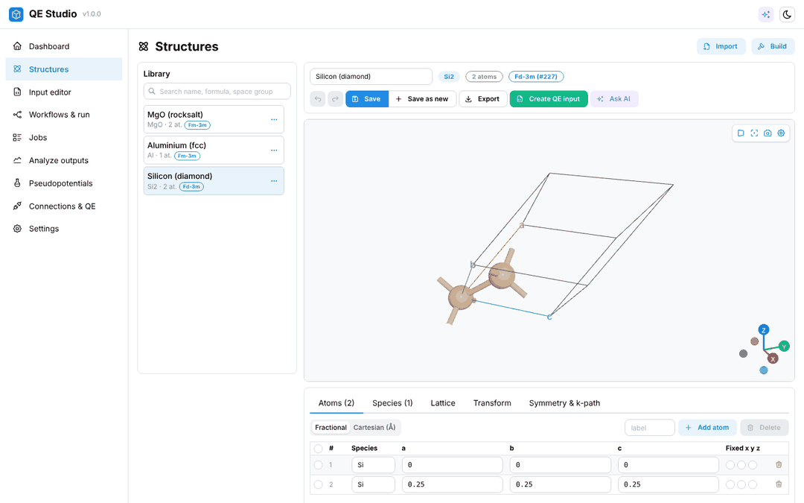
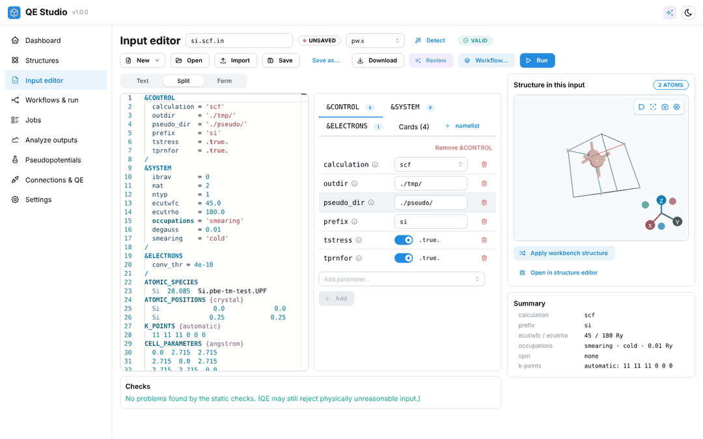
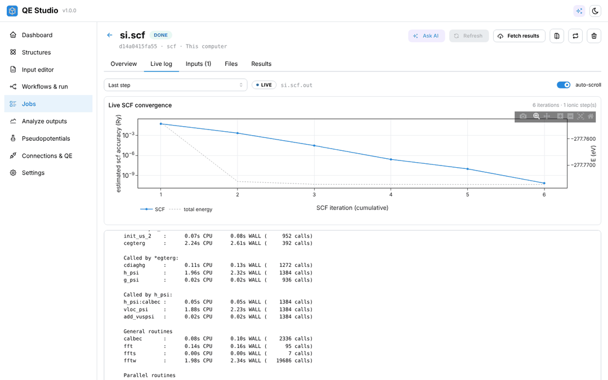
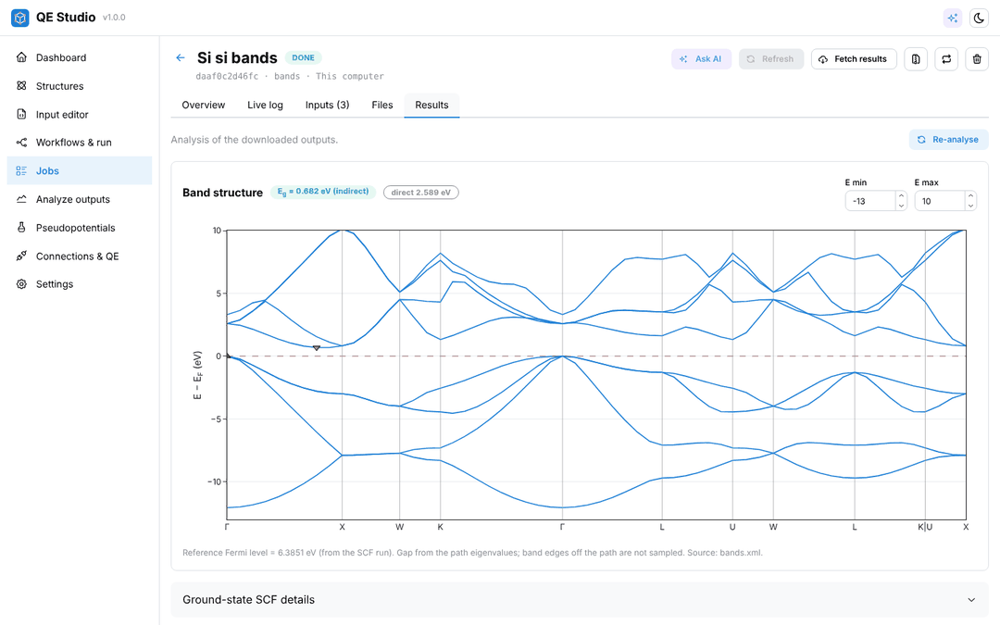

# QE Studio

A desktop workbench for [Quantum ESPRESSO](https://www.quantum-espresso.org) (QE): build and inspect
crystal structures, write and validate QE input files, run calculations on this computer, on SSH
servers and clusters (SLURM/PBS), or on a Kaggle/Jupyter server, and analyse and plot the results.
An optional Claude assistant can give a second opinion on inputs and outputs; one switch turns all AI
features off.

QE Studio runs **on your own computer**: a Python (FastAPI) backend serves a React web UI on
`http://127.0.0.1:8765`. Nothing is exposed to the network by default.

| Structures | Input editor |
| --- | --- |
|  |  |
| **Live log & SCF convergence** | **Band structure** |
|  |  |

<sub>Screenshots: silicon computed with QE 7.6 and test pseudopotentials generated with `ld1.x`
(not production quality).</sub>

## Features

- **Structures**: import CIF, POSCAR, XYZ, extended XYZ, QE inputs/outputs and every other format
  [ASE](https://wiki.fysik.dtu.dk/ase/) reads; download from the
  [Crystallography Open Database](https://www.crystallography.net/cod/) by ID; build bulk crystals,
  supercells, slabs and strained cells; symmetry analysis, primitive/conventional/Niggli cells and
  k-paths with [spglib](https://spglib.readthedocs.io/); interactive 3D viewer (bonds, labels, unit cell,
  orthographic/perspective, PNG export).
- **Input editor**: Monaco editor with QE syntax highlighting, a form view of every namelist variable
  generated from QE's own input documentation, live validation (unknown variables, types, allowed
  values, required cards, species/pseudopotential consistency), templates, and "Apply structure".
- **Workflows** (one click, editable before submission): single `pw.x` run (scf/relax/vc-relax/md),
  band structure, DOS/PDOS (`dos.x`, `projwfc.x`), phonons (`ph.x` → `q2r.x` → `matdyn.x` dispersion
  and DOS), charge density (`pp.x` cube), convergence tests (ecutwfc, ecutrho, k-points, k-spacing, degauss), equation of state.
- **Running**: this computer, SSH (keys, agent or password, jump host, host-key pinning), SLURM and
  PBS batch systems, and Kaggle/Jupyter servers. Jobs keep running and are re-attached when QE Studio
  or the network restarts. Live log with SCF convergence plot, cancel, resubmit, file browser.
- **Getting QE**: one-click install of precompiled QE from conda-forge (Linux, macOS), the system
  package (apt), uploading your own precompiled binaries (`.tar.gz`, `.zip`, `.conda`, `.deb`), or
  pointing to an existing installation / `module load` line.
- **Pseudopotentials**: one-click install of the [SSSP](https://www.materialscloud.org/discover/sssp)
  1.3.0 libraries (with recommended cutoffs), upload of your own UPF files, per-element defaults.
- **Analysis**: energies, forces, stress, magnetization and timings from `pw.x` output and XML; band
  structures with gap detection; DOS and projected DOS; phonon dispersion and DOS (normalisation
  checked against 3·nat); isosurfaces of cube files; EOS fits (Birch–Murnaghan and others from ASE);
  convergence plots. Every plot exports to PNG; outputs can also be uploaded and analysed directly.
- **AI second opinion** (optional, your own [Claude API](https://docs.claude.com) key): ask about an
  input, an output or a result; you choose what is attached. Off-switch in Settings, and a hard
  kill-switch (`QES_AI_DISABLED=1` or `qe-studio --disable-ai`) that the UI cannot override.

## Quick start

Requirements: Python ≥ 3.10 and Node.js ≥ 20 (only to build the UI).

```bash
cd qe-studio            # the unpacked source (or your clone of it)
scripts/setup.sh        # venv + backend + UI build (Windows: scripts\setup.ps1)
scripts/run.sh          # starts http://127.0.0.1:8765 and opens the browser (Windows: scripts\run.ps1)
```

Or with Docker (the image contains the backend and the built UI; your data lives in a volume):

```bash
docker compose up -d    # then open http://localhost:8765
```

First steps in the app:

1. **Connections & QE** → *This computer* → *Quantum ESPRESSO setup*: install QE (conda-forge) or point
   to an existing `bin` directory, then press **Test**.
2. **Pseudopotentials**: install an SSSP library or upload UPF files.
3. **Structures** → *Build* or *Import* → **Create QE input** (or **Workflows & run** for bands, DOS,
   phonons, ...).
4. Submit, watch the live log, and open **Results**.

## Where calculations can run

| Target | How to set it up | Notes |
| --- | --- | --- |
| This computer | built in | Linux/macOS use a bash runner; Windows uses a Python runner. conda-forge has no Windows build of QE, so on Windows use your own binaries, WSL (e.g. as an SSH target), or a remote target. |
| SSH server | *Add SSH server*: host, user, key/agent/password, optional jump host | The first host key is pinned (trust-on-first-use) unless you choose *strict*. Add `module load ...` lines to *Environment setup*. |
| Cluster (SLURM/PBS) | SSH connection with scheduler *slurm* or *pbs* | Partition/queue, walltime, account, nodes, memory, QOS and extra directives are set per job; the runner script doubles as the batch script. |
| Kaggle notebook | In the notebook: *Run ▸ Kaggle Jupyter Server*, copy the *VS Code compatible URL*; in QE Studio: *Add Kaggle / Jupyter* and paste it | The URL contains an access token: treat it like a password. Installing QE needs internet access enabled for the notebook. The notebook session must stay running. |
| Any Jupyter server | Paste the server URL with `?token=...` | JupyterLab, JupyterHub single-user servers, etc. |

How jobs survive restarts: every job directory on the target contains a `.qes/` folder where the
runner records its PID, state, current step and exit code. QE Studio only reads these files, so it can
be closed, restarted or lose the network without affecting running calculations (details in
[docs/ARCHITECTURE.md](docs/ARCHITECTURE.md#job-lifecycle)).

## Configuration

Settings that change behaviour are in the **Settings** page. Process-level options are environment
variables (or `qe-studio --help`):

| Variable | Default | Meaning |
| --- | --- | --- |
| `QES_HOME` | `~/.qestudio` | All data: database, pseudopotentials, cached results, installed QE, API token |
| `QES_HOST` / `QES_PORT` | `127.0.0.1` / `8765` | Bind address. Only bind to other addresses behind an authenticated reverse proxy. |
| `QES_ALLOWED_HOSTS` | (loopback names) | Extra host names accepted in the `Host` header |
| `QES_AI_DISABLED` | unset | `1` disables every AI feature; cannot be re-enabled from the UI |
| `QES_NO_KEYRING` | unset | `1` stores secrets in `QES_HOME/secrets.json` (mode 0600) instead of the OS keyring |
| `QES_STATIC_DIR` | `frontend/dist` | Directory of the built UI to serve |
| `QES_LOG_LEVEL` | `info` | Backend log level |

## Security model (short version)

- The backend listens on 127.0.0.1 only and requires a per-install random token (in
  `QES_HOME/api-token`, mode 0600) on every API call; the `Host` header is checked against an
  allow-list (DNS-rebinding protection).
- Secrets (SSH passwords/passphrases, Jupyter tokens, the Claude API key) are kept in the OS keyring
  (or a 0600 file) and are never sent back to the browser.
- Anyone who can use the UI can run commands on your connections. Do not expose the port.

More in [docs/ARCHITECTURE.md](docs/ARCHITECTURE.md#security-model).

## AI assistant

Add your Claude API key in **Settings ▸ AI**. A question is sent to the Anthropic API only when you
press *Ask*, together with the context items listed in the drawer (for example the current input, or
an output excerpt if *send outputs* is enabled). You can remove items before sending. The default model
can be changed in Settings (the list is fetched from the API with your key). The assistant is
instructed to separate what the files show from general practice and from its own judgement, but its
answers can be wrong: verify them.

## Scientific notes and limitations

- QE Studio prepares inputs and parses outputs; the physics is QE's. Workflow defaults (cutoffs,
  k-point densities, smearing, q-grids) are starting points and must be converged for your system
  (the *Convergence test* workflow helps).
- Band gaps are taken from the eigenvalues on the computed k-points/path; extrema off the path are not
  sampled.
- Phonon DOS: QE Studio uses `matdyn.x`'s tetrahedron DOS and checks that it integrates to 3·nat. With
  the QE 7.6 conda-forge build we observed that the tetrahedron DOS can be all-NaN for some force
  constants and that the Gaussian (`degauss`) DOS integrated to ≈0.70·3·nat for silicon; in those cases
  QE Studio shows a Gaussian DOS it computes from `matdyn.x`'s grid frequencies and weights, and says
  so on the plot.
- Units follow CODATA 2018, as in QE 7.x (verified against `pw.x` output in the test suite).
- Tested on Linux with QE 7.6 (conda-forge, Open MPI). macOS and Windows code paths exist but have not
  been tested on those systems. The Docker image build has not been tested.

## Documentation

- [docs/ARCHITECTURE.md](docs/ARCHITECTURE.md): components, job runner protocol, security model, and
  how to add a scheduler, parser, workflow, executor or page.
- [CONTRIBUTING.md](CONTRIBUTING.md): development setup, commands, coding standards, tests.
- API reference: `http://127.0.0.1:8765/api/docs` (OpenAPI) while QE Studio is running.

## Citations

If you publish results obtained with QE Studio, cite the codes and data you actually used, in
particular:

- Quantum ESPRESSO: P. Giannozzi et al., *J. Phys.: Condens. Matter* **29**, 465901 (2017);
  P. Giannozzi et al., *J. Phys.: Condens. Matter* **21**, 395502 (2009); for GPU builds also
  *J. Chem. Phys.* **152**, 154105 (2020). See the [QE citation page](https://www.quantum-espresso.org/cite/).
- SSSP pseudopotentials: G. Prandini et al., *npj Comput. Mater.* **4**, 72 (2018); Materials Cloud
  Archive 2023.65, [doi:10.24435/materialscloud:f3-ym](https://doi.org/10.24435/materialscloud:f3-ym),
  plus the original reference of each pseudopotential you use.
- ASE: A. H. Larsen et al., *J. Phys.: Condens. Matter* **29**, 273002 (2017).
- spglib: A. Togo, K. Shinohara, I. Tanaka, *Sci. Technol. Adv. Mater.: Methods* **4**, 2384822 (2024),
  [doi:10.1080/27660400.2024.2384822](https://doi.org/10.1080/27660400.2024.2384822).

## License

Not yet chosen; see [NOTICE](NOTICE) for third-party material and its licenses (the QE input schema
in `backend/qestudio/data/qe_schema.json` is derived from GPL-2.0-or-later documentation).
